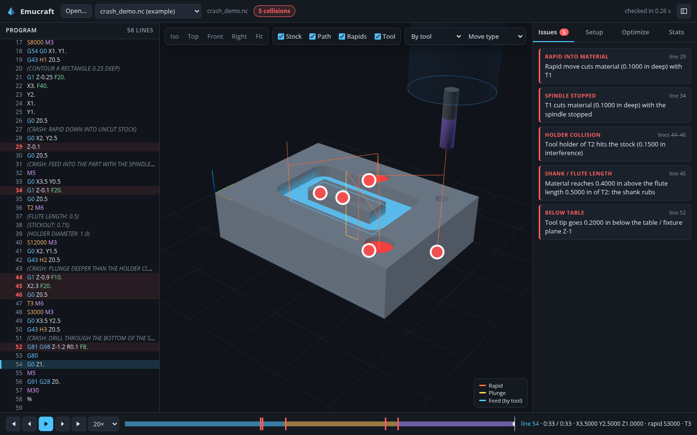
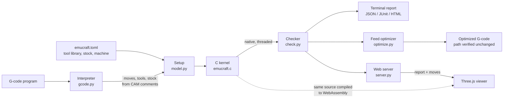

# Emucraft

Emucraft simulates a 3-axis G-code program against the stock, tool, shank and
holder, and tells you whether it will crash before the program reaches the
machine. It is fast enough to run on every program in CI, can rewrite feeds
to slow down in corners and heavy cuts (useful for titanium and Inconel), and
comes with a web viewer built on Three.js.



```console
$ emucraft check examples/crash_demo.nc
FAIL  5 collisions
  x line 29          rapid-cut        Rapid move cuts material (0.1000 in deep) with T1
  x line 34          spindle-off-cut  T1 cuts material (0.1000 in deep) with the spindle stopped
  x lines 44-46      holder           Tool holder of T2 hits the stock (0.1500 in interference)
  x line 45          shank            Material reaches 0.4000 in above the flute length 0.5000 in of T2: the shank rubs
  x line 52          table            Tool tip goes 0.2000 in below the table / fixture plane Z-1
```

## Quick start

```sh
pip install -e .                          # see Installing below
emucraft check examples/makino_roughing.nc
emucraft serve --open                     # viewer on http://127.0.0.1:8765
emucraft optimize examples/pocket_corners.nc --material titanium
```

### Installing

Emucraft needs Python 3.9 or newer and a C compiler (gcc or clang; the
kernel is compiled on first use). There are no other runtime dependencies.

Older Linux installs can be behind; Ubuntu 18.04, a common WSL image, ships
Python 3.6. Check with `python3 --version`. If it is older than 3.9,
[uv](https://docs.astral.sh/uv/) installs a current Python for your user
without root:

```sh
curl -LsSf https://astral.sh/uv/install.sh | sh    # then open a new terminal
cd emucraft
uv venv --python 3.12
source .venv/bin/activate
uv pip install -e .
sudo apt install build-essential                   # only if gcc is missing
emucraft check examples/crash_demo.nc
```

On WSL you can instead install a newer distribution from PowerShell
(`wsl --install -d Ubuntu-24.04` comes with Python 3.12). `emucraft serve`
works from WSL: open http://localhost:8765 in your Windows browser.

## How it fits together



- **Interpreter** (`emucraft/gcode.py`) turns Fanuc-style programs (PowerMill,
  Fusion 360, Mastercam and similar posts) into one continuous path of
  straight moves. Arcs (IJK or R, any plane, helical) become chords within
  0.0002". It handles canned cycles, G91, G52, G53/G28 retracts, dog-leg
  rapids, macro variables and expressions, and `G4 X` dwells. `G65` calls and
  `IF` blocks are skipped with a warning, never executed as moves. Tool and
  stock data are read from CAM header comments (`DIAMETER:`,
  `Tool Holder Diameter:`, `MIN X:` ...), from `#127`/`#128` holder and
  stick-out variables, and from your config file. Anything it cannot
  simulate faithfully becomes a message instead of a silent guess.
- **Kernel** (`kernel/src/emucraft.c`) models the stock as a height field and
  sweeps each move analytically. For every cell under a move it finds the
  lowest point of the moving tool surface (flat, ball, bull nose or
  drill/chamfer), so long moves cost no more than short ones. Shank and
  holder cylinders are checked in the same pass, split into "before the
  cutter reaches this cell" and "after it leaves". The file is freestanding
  C99: the same source builds as a native library (Python, multithreaded by
  row bands) and as a 20 KB WebAssembly module for the browser. A test
  proves the two produce bit-identical results.
- **Checker** (`emucraft/check.py`) runs the kernel and adds path-level
  checks. It groups kernel events into issues with line ranges, positions
  and depths, and estimates cycle time.
- **Viewer** (`emucraft/web/`) replays the same moves through the WASM kernel.
  The height field is a GPU texture updated in place (only the rectangle the
  kernel touched is uploaded each frame) and drawn by a displacement shader,
  so playback and scrubbing are smooth even for large programs.

## What gets checked

| Issue | Meaning |
|---|---|
| `rapid-cut` | A rapid (G0, G28/G53 retracts, canned-cycle rapids) removes material |
| `spindle-off-cut` | Material is removed while the spindle is stopped (M5, after M6, before M3) |
| `shank` | Material taller than the flute length is cut: the shank rubs. Also a shank wider than the cutter touching the stock |
| `holder` | The holder cylinder (`holder_diameter`, bottom at `stickout` above the tip) touches the stock, including stock left beside the cut |
| `table` | The tip goes below the table / fixture plane (default: the stock bottom) |
| `link-cut` | A feed move at or above `link_feed` (high-feed "fly" links) removes material (warning) |
| `travel` | The path leaves the machine travel limits, if configured |
| `tool` | A tool is used for cutting but its geometry is unknown |

The interpreter also reports program problems: arcs whose end point is off
the circle, feed moves without F, unsupported codes (G68, G51, G43.4 ...),
tool length offset H not matching the tool (`G43 H1` with T20), undefined
macro variables, and more.

The model is 2.5D: the stock is a height field seen from +Z. Undercuts,
4th/5th axis and cutter compensation offsets are out of scope (G41/G42 paths
are simulated as tool-center paths and reported). Several work offsets are
simulated as one setup. Numbers without a decimal point (`X1`) are read as
whole units, as on controls with decimal-point input enabled. When no stock
size is given anywhere, it is estimated from the cutting moves (with a
warning), which can put the stock top too high if a feed move starts in air.

## Moonshot: robot sanding

[Moonshot](moonshot/README.md) plans how a long cylinder, such as a sanding drum held against a part by a robot,
touches every point of a solid without hitting the part or its fixture, keeps the drum level with the wood grain,
steps the contact along the drum between passes so it wears evenly, and writes a FANUC program for Roboguide.

```sh
pip install -e ".[moonshot]"              # Python 3.10+: numpy, scipy, numba, trimesh, matplotlib
moonshot-web                              # its web page on http://127.0.0.1:8766/
moonshot samples/wave_plate.stl --spacing 0.05 --track --out results/plate
python -m moonshot.fanuc results/plate
```

- **Web page** (`moonshot-web`, its own server and Docker image): upload a model or pick a sample, plan it, and look at the result
  in 3D: reach, grain tilt, tracking and passes on every grid point, and the drum wherever you click. Write the
  robot program and play it back along the part, render the step pictures, and download every file.
- **MCP server** (`moonshot-mcp`, `pip install -e ".[moonshot-mcp]"`): the same pipeline for an MCP client, run as
  its own process or container. It is separate from emucraft's own G-code MCP server, `emucraft mcp`.
- **Command line**: `moonshot` (or `python -m moonshot`) and `python -m moonshot.fanuc`.

Moonshot is optional: without its extras, emucraft installs and runs exactly as before.

## Jobs with several programs

CAM systems often post one file per toolpath. A finishing program checked on
a fresh block reports rapids into pockets that the roughing program had
already cleared. `--chain` checks the programs in order on one shared stock:

```sh
# alone, the finishing program's rapid into the pocket hits solid stock: FAIL
emucraft check examples/pocket_finish.nc
# after the roughing program, the pocket is already cleared: both PASS
emucraft check --chain examples/pocket_corners.nc examples/pocket_finish.nc
```

With `--html`, each report starts from the stock the earlier programs left
behind.

## Feed optimization

```sh
emucraft optimize part.nc -o part.opt.nc --material inconel
```

Two rules; where both apply, the slower feed wins:

- **Corners.** The cutting path's direction is measured over a short window
  (default a quarter of the tool diameter), so a sharp corner and a tight arc
  made of many tiny segments are both found. The feed drops to
  `corner_factor` (scaled by how sharp the corner is) within `corner_zone`
  tool diameters before and after it.
- **Tool load.** The simulation measures how much material every short piece
  of the path removes. Where the material removal rate goes above
  `load_limit` × the tool's typical cut (inside corners, full-width slots,
  rest material), the feed is lowered to hold that rate. Because the rule
  works on removal rate, a ramp or plunge that is already programmed slowly
  is only slowed further if it still removes material faster than the limit.

Presets (`aluminum`, `steel`, `stainless`, `titanium`, `inconel`) are starting
points; every value can be set on the command line, in the viewer's Optimize
tab or in `[optimize]` of the config. Only F words change. Plain G1 lines are
split where a slow zone starts or ends; arcs and cycles get their slowest
feed. The modal feed is restored after each zone. The optimizer
re-interprets its own output and refuses to write it unless the path matches
the original exactly.

## Configuration

`emucraft check part.nc` uses an `emucraft.toml` (or `.json`) found next to
the program or in any folder above it; `-c` picks one explicitly. See
[`examples/emucraft.toml`](examples/emucraft.toml):

```toml
units = "inch"                 # units of the lengths in this file

[machine]
rapid_rate = 1200              # in/min, for cycle time
rapid_mode = "dogleg"          # rapids that move each axis at full speed
table_z = -1.0                 # lowest point the tip may reach

[check]
link_feed = 700                # feed moves this fast must not cut
resolution = 0.002             # cell size; default ~6 million cells

[tools.20]                     # fills in what the CAM post does not write
flute_length = 1.0
holder_diameter = 1.3
stickout = 1.4

[default_tool]
holder_diameter = 1.5
```

Tool values are applied in this order, later winning: program comments,
`[default_tool]` (only for fields the program does not set),
`[tools.N]`, then command-line or viewer overrides
(`--tool 20:holder_diameter=1.5` or `--tool '*:stickout=2'`). Reports show
where each value came from. Holder checks need both `holder_diameter` and
`stickout`.

### Reading tool data from comments

Tool and stock values come from CAM comments in three ways, all adjustable
in the config:

- **Comment rules** match known header formats (`DIAMETER:`,
  `Tool Holder Diameter:`, `FLUTE LENGTH:`, `SHANK DIA:`, `MIN X:` ...).
  `[[comment_rules]]` adds regexes that run before the built-in ones.
- **Variable rules** read macro variables: `#127` is the holder length and
  `#128` the stick-out by default. `[variable_rules]` adds or remaps them.
- **Label aliases** catch any other `(label: value)` comment whose label is
  close to a known name, forgiving case, punctuation and typos:
  `(HOLDER DIAMTER: 2)`, `(Tool-Holder Length = 3.5)`, `(LOC .75)`. Aliases are
  only tried when no rule matched. Aliases shorter than five letters (`dia`,
  `loc`) must match exactly. A loose match is listed as a `comment-label` info
  message. `[check] fuzz_threshold` (0-1, default 0.85) sets how close a label
  must be, and 1 means exact only. `[comment_aliases]` replaces the alias list
  of a target:

```toml
[check]
fuzz_threshold = 0.9

[comment_aliases]
"tool.stickout" = ["stickout", "gauge from holder"]
"tool.flute_length" = ["flute length", "loc", "length of cut"]
```

A length followed by `mm`, `in` or `"` is converted to the program's units
once they are known. `emucraft info part.nc` lists what was read.

## In CI

`emucraft check` exits with 0 when there are no collisions, 1 on collisions
or program errors (`--strict` also fails on warnings), and 2 on bad input.
It writes JUnit XML for test dashboards and a single-file HTML report with the
full interactive viewer (no server or network needed):

```yaml
# .github/workflows/gcode.yml in a repository of posted programs
name: G-code check
on: [push, pull_request]
jobs:
  check:
    runs-on: ubuntu-latest
    steps:
      - uses: actions/checkout@v4
      - uses: actions/setup-python@v5
        with: { python-version: "3.12" }
      - run: pip install "emucraft @ git+https://github.com/amunchet/emucraft"
      - run: emucraft check programs/*.nc --junit junit.xml --html report.html
      - uses: actions/upload-artifact@v4
        if: always()
        with: { name: emucraft-report, path: "report*.html" }
```

## MCP server

`emucraft mcp` serves Emucraft over the Model Context Protocol (stdio, or
streamable HTTP with `--http`), so a generative CAM pipeline or an agent can
check each program it produces. It
needs Python 3.10+ and the `mcp` extra:

```sh
pip install -e ".[mcp]"
```

```json
{"mcpServers": {"emucraft": {"command": "emucraft", "args": ["mcp"]}}}
```

| Tool | What it does |
|---|---|
| `check_program` | Full collision check. Returns status, issues with lines and depths, interpreter messages, and the tool geometry with where each value came from. Takes `stock`, per-tool `tools` overrides and `resolution` |
| `program_info` | What was read from comments and macro variables, with each value's line and text, without simulating. Pass a few comment lines as `gcode` to try detection settings |
| `list_programs` | The programs in the `--programs` folder, as `path` values for the other tools |
| `get_settings` / `update_settings` / `reset_settings` | View and change the server's saved settings, mainly comment detection (`comment_aliases`, `comment_rules`, `variable_rules`, `check.fuzz_threshold`) and tool defaults |

Programs are passed as a file `path` or inline `gcode`. Each call uses the
first config it finds: `config_path`, an `emucraft.toml` next to the program,
then the saved settings. The saved settings are an ordinary emucraft JSON
config at `~/.config/emucraft/mcp.json` (override with
`EMUCRAFT_MCP_CONFIG`), so `emucraft check -c` can use them too. Every
result names the config it used.

```sh
emucraft mcp --http --host 0.0.0.0 --port 8000 --programs /programs  # streamable HTTP at /mcp, GET /health
```

With `--programs`, `path` and `config_path` are relative to that folder and
cannot leave it. Over HTTP without it, only inline `gcode` is accepted, so a
caller cannot read the server's files. With `EMUCRAFT_TOKEN` set, `/mcp`
needs `Authorization: Bearer <token>`. Deployed, this is the `emucraft-mcp`
service (see [Web Deployment](#web-deployment)).

## Web Deployment
Each web app has its own Docker image, and none has authentication of its own - they are meant to sit behind a reverse proxy (Caddy) that handles that:

| Service | Image, built from | Serves |
|---|---|---|
| `emucraft` | `Dockerfile` | the G-code viewer (`emucraft serve`) on port 8000 |
| `moonshot` | `moonshot/Dockerfile` (repository root as context) | Moonshot's web page (`moonshot-web`) on port 8000, models and runs in the `moonshot-web` volume |
| `laser` | `laser/Dockerfile` | the laser engraving simulator, a static build served by nginx on port 80 |
| `laser-api` | `laser/Dockerfile.api` | the laser customer GLB API (`laser/server.mjs`) on port 8001; call it from the shop's backend, see [Customer GLB API](#customer-glb-api-laserservermjs) |
| `moonshot-mcp` | the `moonshot` image | Moonshot's MCP server on port 8000 (`/mcp`), its own `moonshot-mcp` volume; only with `--profile moonshot-mcp` |
| `emucraft-mcp` | the `emucraft` image | emucraft's MCP server (`emucraft mcp --http`) on port 8000, settings in the `emucraft-mcp` volume, programs from `/programs`; only with `--profile emucraft-mcp` |
| `laser-mcp` | the `laser-api` image | the laser MCP server (`laser/mcp.mjs`) on port 8000; only with `--profile laser-mcp`, see [Laser MCP server](#laser-mcp-server-lasermcpmjs) |

The compose file joins an **external** Docker network (`emucraft` by default, override with `EMUCRAFT_NETWORK`) and publishes no ports:

```bash
docker network create emucraft   # once, if your Caddy stack doesn't already create it
docker compose up -d --build                                            # emucraft, moonshot, laser, laser-api
MOONSHOT_TOKEN=... docker compose --profile moonshot-mcp up -d --build  # also Moonshot's MCP server
COMPOSE_PROFILES=moonshot-mcp,emucraft-mcp,laser-mcp docker compose up -d --build  # all three MCP servers
```

Then, in the Caddy stack (attached to the same network), serve all three on one host, each under its own path:

```
example.com {
    # ...your auth...
    redir /emucraft /emucraft/
    redir /moonshot /moonshot/
    redir /laser-simulator /laser-simulator/
    handle_path /emucraft/* {
        reverse_proxy emucraft:8000
    }
    handle_path /moonshot/* {
        reverse_proxy moonshot:8000
    }
    handle_path /laser-simulator/* {
        reverse_proxy laser:80
    }
}
```

The production config is in [`Caddyfile`](Caddyfile), kept for reference. It adds Auth0 sign-in and write permissions (via caddy-auth0), the MCP servers at `/moonshot-mcp/mcp`, `/emucraft-mcp/mcp` and `/laser-mcp/mcp`, an `/admin` page, and a redirect from `/` to `/emucraft/`. The `/admin` page mints tokens for every `auth0 { mcp }` route in the Caddyfile, so it covers all three MCP servers; Caddy checks the tokens and strips them, so leave `MOONSHOT_TOKEN`, `EMUCRAFT_TOKEN` and `LASER_MCP_TOKEN` unset there.

`handle_path` strips the prefix, so each app still sees itself at `/`. The pages use only relative URLs, so they work under any prefix, but they need the trailing slash, which is why each path has a `redir`. Clicking an app's name in its top bar switches to the others at `/emucraft/`, `/moonshot/` and `/laser-simulator/`. These paths are fixed in `APPS` in `emucraft/web/js/util.js` and its copy in `laser/src/main.js`. Anywhere else, such as running locally, it links to each app's default port on the same host instead (8765, 8766, and the laser simulator's dev server on 5173). Moonshot's MCP server checks `MOONSHOT_TOKEN` itself (set `MOONSHOT_URL` to its public address for download links); see [moonshot/README.md](moonshot/README.md#mcp-server).

The viewer lists the bundled `examples/` plus anything in `/programs` inside the container; uncomment the volume in `docker-compose.yml` to mount your own folder (an `emucraft.toml` there is picked up as the default config).

## Laser engraving simulator (`laser/`)
A separate, browser-based section of Emucraft that simulates laser engraving a bitmap into a solid and renders the result with three.js for customer-facing previews.

Run it: `cd laser && npm install && npm run dev` (tests: `npm test`, production bundle: `npm run build`).

Inputs:
- A model: STL, OBJ, GLB/GLTF. It is centred in XY with its lowest point at Z = 0. The laser fires along -Z.
- A bitmap: any browser-readable image, converted to greyscale. By default black removes the most material and white removes none (`invert` flips this). Transparent pixels are not burned.
- A built-in demo plate and bitmap load on startup.

Workflow:
1. **Align**: the image is projected straight down onto the model. Drag to move it, Shift+drag to rotate (hold Ctrl as well to snap to 15°), Alt/Ctrl+wheel to scale, or type values. By default one pixel is one spot at focus; "Fit to model" scales the image to the part instead.
2. **Laser**: set spot size at focus, lens focal length, beam diameter at the lens, focus offset, power and rated power, depth per pass, passes, ablation threshold and gamma.
3. **Simulate**: runs in a Web Worker (`src/worker.js` → `src/sim.js`).
4. **Result**: choose a material preset (anodized aluminium, stainless, brass, acrylic, walnut, maple, slate, and Altamont's Super Rosewood / Super Blackwood / Super Walnut Dymondwood) or upload a custom texture. The Dymondwood presets are dyed veneers stacked in Z and coloured by height, so a flat face shows one layer, curvature shows contour bands, and deep cuts expose the layers underneath. The texture scale sets the veneer thickness: scale ÷ 144, so the default 80 mm gives about 0.55 mm. Adjust lighting and exposure. Export a GLB for the website or a PNG screenshot.

Model (`laser/src/sim.js`):
- The top surface under the image is rasterized into a height grid. The grid uses the image pixels, optionally supersampled, and is capped at 4M cells.
- The spot diameter at a distance dz from the focal plane is `d = sqrt(spot² + (dz · D / f)²)`. Here D is the beam diameter at the lens and f is the focal length, so the Rayleigh range is `spot · f / D`.
- The focal plane sits at the highest point under the footprint, plus the focus offset.
- Passes are simulated in up to 24 steps. In each step every cell removes `max(0, grey · power/max · (spot/d)² − threshold) / (1 − threshold) · depth_per_pass`. That removal is spread by a Gaussian with σ = d/4, using the cell's own current defocus. Deeper cuts therefore grow wider, shallower and fuzzier.

Sample: `laser/samples/` has a parametric full-size 1911 grip panel with a strong crown (7.6 mm thick at the centre, ~3.3 mm at the edges before the round-over) (`node make_1911_grip.mjs` writes `1911_grip.stl`) and a full-coverage design that bleeds past the panel edges (`1911_grip_design.png`, drawn by `make_1911_bitmap.mjs`, which needs playwright and a Chromium). Load both, then set W = 47 mm (aspect locked), X = Y = 0.125 and angle 0 to line the design up with the panel.

### Customer GLB API (`laser/server.mjs`)
A small Node service runs the same simulation and returns **one `.glb` file** to hand to a three.js frontend. The file shows the engraved part faithfully but does not carry the solid itself.

Run it with `cd laser && npm install && node server.mjs`. It listens on `127.0.0.1:8001`. Environment variables:
- `HOST`, `PORT`
- `LASER_JOBS`: concurrent jobs (default 2)
- `LASER_TIMEOUT_S`: per-job time limit (default 300)
- `LASER_MAX_MB`: request body cap (default 64)
- `LASER_TOKEN`: if set, requests must send `Authorization: Bearer <token>`
- `LASER_SECRET`: keys the per-part size factor (below). If unset, a random one is made at each start, so a restart gives the same part a new factor.

With Docker, `docker compose up -d --build` also starts the `laser-api` container (built from `laser/Dockerfile.api`), capped at 4 GB of memory and 4 CPUs. Set `LASER_TOKEN` and `LASER_SECRET` in the environment that runs compose to pass them through.

A render of the sample grip takes about 30 s of CPU and peaks at about 0.5 GB of memory. Call it from the shop's backend and pass the GLB on to the browser, or set `LASER_TOKEN`. Don't route it publicly without authentication. If the backend reaches it through Caddy:

```
handle /api/laser/* {
    reverse_proxy laser-api:8001
}
```

Guard rails:
- Images over 25 MP and placements so small that the spot would cover hundreds of pixels are rejected before any work starts.
- A job whose client disconnects is stopped.

- `GET /api/laser/info` returns the material presets, the laser defaults and the output defaults.
- `POST /api/laser/render` takes a JSON job and returns `model/gltf-binary`. A summary goes in the `X-Laser-Summary` header: texture size, triangle counts, max engraved depth and bytes. It deliberately contains nothing that gives away the part's size. A bad job gets `400 {"error": "..."}`; unknown fields are rejected, not ignored. When `LASER_JOBS` jobs are already running, it returns `503`.

```json
{
  "model": { "format": "stl", "data": "<base64 STL (binary or ASCII) or OBJ text>" },
  "image": { "data": "<base64 PNG or JPEG>" },
  "placement": { "cx": 0.125, "cy": 0.125, "angle_deg": 0, "width_mm": 47 },
  "laser": { "focus_offset_mm": -2, "passes": 10 },
  "supersample": 2,
  "material": { "preset": "super_rosewood", "tex_scale_mm": 80 },
  "output": { "mesh_mm": 0.5, "max_texture": 2048, "true_scale": false }
}
```

Field defaults:
- **Placement:** the same frame and numbers the app's Alignment panel shows (model centred in XY, lowest point at Z = 0). If width and height are both left out, one pixel equals one spot. If only one is given, the other keeps the image's aspect ratio.
- **`laser`:** any subset of the simulator's laser parameters.
- **`material`:** a preset, optionally overriding `color`, `mark`, `rough`, `metal`, `mark_rough` and `mark_metal`, or supplying a custom base `texture` (base64 image).
- **`output.mesh_mm`:** the geometry resolution, 0.1–2 mm. It is never finer than 2 texels or 1/1024 of the part.
- **`output.max_texture`:** caps the texture size.
- **`output.true_scale`:** keeps real size in metres. By default the part is scaled so its longest side is 1.

What the file contains:
- **Shape:** only the side the laser sees, as an open shell. The front relief is sampled every `mesh_mm` (0.5 mm by default) from the *unengraved* surface, and the outline walls drop to the base. There is no back, no closed volume, and no real-world scale unless asked for. Names and metadata are stripped.
- **Scale hiding:** the file is a faithful render of a stand-in part. The stand-in is the real part and its placement scaled by a factor between 0.9 and 1.1, engraved with the same laser settings. Every length in the file measures the stand-in: the mesh pitch, the texture tiles, the bitmap's pixel grid, the spot blur, defocus and depths. So the real size is known only to within ±10 %. The factor comes from an HMAC of the part's geometry, so rendering the same part again gives the same factor and repeated renders can't be averaged to narrow it down. A job with no `width_mm` or `height_mm` puts 1 pixel = 1 spot on the stand-in, so the design's size relative to the part varies by up to ±10 %; give a size to fix it. `true_scale` turns all of this off.
- **Detail:** fine detail is in the textures. Colour holds the material and the burn marks, a tangent-space normal map holds the engraving and the fine surface shape, a packed texture holds roughness, metalness and clearcoat, and an alpha mask cuts the exact outline and holes.
- **Size:** about 5–7 MB for the sample grip (the full-detail app export is about 78 MB). It passes the Khronos glTF validator with no errors or warnings.

Limits of the protection: anything a browser can display can be captured, so this makes reverse engineering impractical, not impossible.
- The silhouette and the front shape at `mesh_mm` resolution are visible by nature.
- Someone could rebuild an approximate front surface by integrating the normal map.
- They could close it into a plausible solid by hand.
- They would not get the back, mating features, true dimensions, or engraving depths as geometry.

Raise `mesh_mm` for coarser geometry; the normal map keeps the render looking the same.

Viewing: `laser/viewer.html` is a reference customer viewer. It is plain three.js with the simulator's studio lighting; open it with `?src=<glb url>` or drop a file on it. Any `GLTFLoader` setup works:

```js
const gltf = await new GLTFLoader().loadAsync('/part.glb'); // from POST /api/laser/render
scene.add(gltf.scene);              // Y up, longest side 1 (unless true_scale)
controls.maxPolarAngle = Math.PI * 0.47; // there is no back: keep the camera above the part
```

### Laser MCP server (`laser/mcp.mjs`)
The same jobs as MCP tools, for an agent, over streamable HTTP at `/mcp` (stateless; `GET /health` for liveness):

| Tool | What it does |
|---|---|
| `laser_info` | The material presets, the laser defaults and the option defaults, as `GET /api/laser/info` |
| `render_glb` | A job, with the model and image as `model_format`, `model_data` and `image_data` (base64) and the other fields as above. Returns the summary and the GLB as an embedded `model/gltf-binary` resource. Bad jobs come back as tool errors with the reason |

Run it with `cd laser && node mcp.mjs` (port 8002) or as the `laser-mcp` service. It takes the API's environment variables (`LASER_TOKEN` guards `/mcp`), and should get the API's `LASER_SECRET` so a part gets the same stand-in size from both. Tool calls carry the files in base64, so the request cap `LASER_MAX_MB` applies to the whole call.

Limitations and next steps: STEP/IGES import (would need occt-import-js), lasers that don't fire straight down or rotary axes, heightmap export, and splitting the 720 kB bundle into smaller chunks.

## Performance

Measured on a 4-core container:

| Program | Check | Notes |
|---|---|---|
| `makino_roughing.nc` (3,126 lines, 0.375" end mill) | 0.3–0.4 s | 5.5 M cells at 0.0019", 4 threads; about 1 s for a whole `emucraft check` run including start-up |
| 200,000-line 3D ball-mill finish | 5.1 s | 5.5 M cells, 4 threads (11 s on 1) |
| Browser replay of `makino_roughing.nc` | 0.2 s | WebAssembly, 1.5 M cells |

The interpreter handles about 200,000 plain lines per second. The kernel
merges runs of nearly collinear moves (within half the event tolerance)
before sweeping, and runs row bands on all cores.

## Development

```sh
make -C kernel test        # C unit tests: sweeps against brute-force references
make -C kernel             # native library + WebAssembly (needs clang with wasm32/wasm-ld)
python -m pytest           # Python suite; WASM/native parity tests need Node.js
pip install -e ".[moonshot-dev]" && python -m pytest tests/moonshot   # Moonshot (Python 3.10+, about 5 minutes)
```

`tests/moonshot/` is skipped when Moonshot's dependencies are not installed.

- `emucraft/web/wasm/emucraft.wasm` is committed so the viewer works without
  clang; rebuild it after changing `kernel/src/emucraft.c`.
  `tests/test_wasm_parity.py` fails if it drifts from the native build.
- `emucraft/web/vendor/three/` holds a minified single-file build of three.js
  r186 (MIT), so the viewer and HTML reports work offline.
- The viewer is plain ES modules with no build step.

The earlier prototypes (the Open3D renderers, the point-per-0.001" XYZ file
pipeline and the first kernel) were replaced by this implementation; they
remain in the git history before this change.
